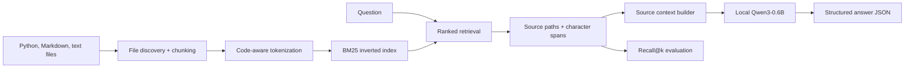

# RAG Against the Machine

**Code-aware RAG for vLLM using Tree-sitter, custom BM25 and local Qwen3-0.6B, achieving 85% docs and 82.8% code Recall@5 on public datasets.**

A local, end-to-end pipeline that indexes the **vLLM 0.10.1** source tree, retrieves relevant code and documentation with **BM25**, and answers questions with **Qwen3-0.6B**. Built for the [42 Network](https://42.fr/) RAG Against the Machine project.

**Python 3.10+ · Tree-sitter · BM25 · Qwen3-0.6B · Pydantic · CLI**

> **Measured on the supplied public evaluation sets:** **85.0% documentation Recall@5** and **82.8% code Recall@5**, using a 2,000-character chunk size. These are retrieval scores, not end-to-end answer-accuracy scores.

## Why this project?

Searching a large codebase is different from searching ordinary prose. Function names, file paths, signatures, and implementation details matter. This project combines:

- **Syntax-aware chunking:** Tree-sitter keeps Python code organized around top-level syntax nodes; Markdown and text use overlapping windows.
- **Code-aware tokenization:** index complete identifiers and their snake_case / CamelCase components.
- **Fast, inspectable retrieval:** a custom inverted index with BM25 scoring, not an external vector database.
- **Traceable evidence:** every retrieved result contains the original file path and exact character range.
- **Local answer generation:** a Qwen3-0.6B model answers using the retrieved source text.
- **Reproducible evaluation:** CLI commands evaluate retrieval with Recall@k on the project's labeled datasets.

## How it works



**Source provenance is preserved:** a result's `file_path`, `first_character_index`, and `last_character_index` locate the exact original passage (end index exclusive). This matters for both grounding and scoring.

## Quick start

**Requirements:** Python 3.10+, [uv](https://docs.astral.sh/uv/), and enough disk/RAM for PyTorch and the local Qwen model. The default install uses the CPU PyTorch package index on Linux. Initial dependency/model downloads require an internet connection.

```bash
git clone https://github.com/laghzal49/Rag-Against-the-machine.git
cd rag-v2
uv sync
```

### Try it with your own documents

You can test the search pipeline without downloading the 42 evaluation corpus or a language model:

```bash
mkdir -p example_corpus
printf '# HTTP server\nThe server accepts requests and returns responses.\n' > example_corpus/notes.md

uv run python -m src index --data_path example_corpus --max_chunk_size 2000
uv run python -m src search "What does the HTTP server do?" --k 5
```

To generate an answer as well (downloads the Qwen model on first use):

```bash
uv run python -m src answer "What does the HTTP server do?" --k 5
```

The index is written to `data/processed/index.pkl`. The example corpus is only a quick local test; the reported benchmarks use the supplied vLLM corpus.

### Run on the vLLM evaluation corpus

Place the **vLLM 0.10.1** snapshot at `data/raw/vllm-0.10.1/`. When indexing the default `data/raw/` path, the application attempts to download the course-provided archive automatically if it is missing. That archive URL is hosted by 42 and may not be accessible to everyone.

```bash
uv run python -m src index --max_chunk_size 2000
uv run python -m src search "How do I configure the OpenAI-compatible server?" --k 5
uv run python -m src answer "How do I configure the OpenAI-compatible server?" --k 5
```

To evaluate retrieval, put the appropriate public question JSON files under `data/datasets/UnansweredQuestions/` and `data/datasets/AnsweredQuestions/`. The course corpus and question datasets are **not included** in this Git repository.

```bash
uv run python -m src search_dataset \
  --dataset_path data/datasets/UnansweredQuestions/dataset_docs_public.json \
  --save_directory data/output/search_results/UnansweredQuestions \
  --k 5

uv run python -m src evaluate \
  --student_search_results_path data/output/search_results/UnansweredQuestions/dataset_docs_public.json \
  --dataset_path data/datasets/AnsweredQuestions/dataset_docs_public.json \
  --k 5
```

Replace `docs` with `code` to run the code-question set. `answer_dataset` generates answers for a saved retrieval-results file; it invokes the local model once per question and is considerably slower than retrieval.

## Benchmark results

Measured by the project author on the supplied **vLLM 0.10.1** corpus using **k=5** and the course's **2,000-character maximum source context**. These are local measurements, not independently reproduced benchmark results.

| Maximum chunk size | Index time | Docs Recall@5 | Code Recall@5 |
| ---: | ---: | ---: | ---: |
| **2,000 characters** | **7.56 s** | **85.0%** | **82.8%** |
| 1,000 characters | 10.35 s | 84.0% | 71.7% |

At 2,000 characters, the index contained **13,717 chunks**, built from **1,847 nonempty source files** (1,969 scanned). The public evaluation sets contained **100 documentation questions** and **99 code questions**. Dataset retrieval runs took approximately **2.3 s (docs)** and **2.2 s (code)**, including process startup and index loading.

**What this tells us:** smaller chunks were not automatically better. They increased the number of passages but substantially reduced recall on code questions. The scores are for **retrieval only**; they do not prove that generated answers are accurate or that private evaluation sets have the same scores.

## Engineering details

| Stage | Implementation | Reason |
| --- | --- | --- |
| Discovery | Scan Python, Markdown, and plain-text files | Supports both code and docs |
| Chunking | Tree-sitter for Python; overlapping text windows | Respect code structure and avoid cutting prose at arbitrary boundaries |
| Tokenization | Lowercase, stop-word filtering, whole/split identifiers | Match function names and natural-language queries |
| Index | Custom inverted index and BM25 (`k1=1.5`, `b=0.5`) | Explainable lexical relevance scoring |
| Retrieval | Top-k ranked source spans | Preserve inspectable provenance |
| Generation | Qwen3-0.6B via Transformers | Run answers locally with retrieved context |
| Schemas | Pydantic models | Validate input, results and generated-output structures |
| Evaluation | Recall@1/3/5/10 | Measure source retrieval separately from generation |

### Repository map

```text
src/
├── chunking/       # Tree-sitter and text chunking
├── tokenizer/      # Identifier-aware lexical analysis
├── indexing/       # Corpus discovery and index construction
├── retrieval/      # Custom BM25 and ranked search
├── generation/     # Context building and local Qwen answers
├── models/         # Pydantic data contracts
├── evaluation/     # Recall metrics
├── commands/       # Fire CLI commands
└── __main__.py     # CLI entry point
```

### CLI reference

| Command | Purpose |
| --- | --- |
| `index` | Build/persist an index from source files |
| `search` | Retrieve ranked, source-linked passages |
| `answer` | Retrieve and generate a local answer |
| `search_dataset` | Run retrieval over a JSON question set |
| `answer_dataset` | Generate answers for saved search results |
| `evaluate` | Calculate retrieval Recall@k against labeled sources |

Run `uv run python -m src --help` for the command list. The `Makefile` also provides `install`, `run`, `debug`, `lint`, and `clean` tasks.

## Design trade-offs & limitations

- **Lexical, not semantic retrieval:** BM25 is fast and debuggable, but paraphrases without overlapping terms can be missed.
- **Finite context:** generation limits the input to 2,048 tokens and new text to 150 tokens by default. Lower-ranked sources may be truncated.
- **Answer grounding is not guaranteed:** generated text should be checked against the reported source spans; an insufficient-evidence answer is possible.
- **Local resources required:** downloading and running Qwen/PyTorch may be slow or memory-intensive on some systems.
- **Trusted indexes only:** the persisted index uses Python `pickle`. **Never load index files from untrusted sources**; rebuild an index from trusted source files instead.
- **Corpus distribution:** vLLM source and the 42 question/evaluation datasets must be obtained separately.

## Credits and references

Created for the **42 Network** curriculum by **tlaghzal**.

- [vLLM](https://github.com/vllm-project/vllm) · [Tree-sitter](https://tree-sitter.github.io/tree-sitter/) · [BM25](https://nlp.stanford.edu/IR-book/html/htmledition/okapi-bm25-a-non-binary-model-1.html)
- [Qwen3-0.6B model](https://huggingface.co/Qwen/Qwen3-0.6B) · [Pydantic](https://docs.pydantic.dev/) · [uv](https://docs.astral.sh/uv/)
- [42 project subject](https://projects.intra.42.fr/projects/rag-against-the-machine)

AI assistance was used for documentation, type annotations, edge-case review, and style checks. Implementation details and the reported measurements are documented for review and independent reproduction.
